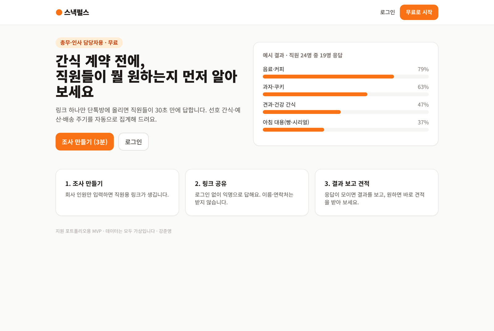
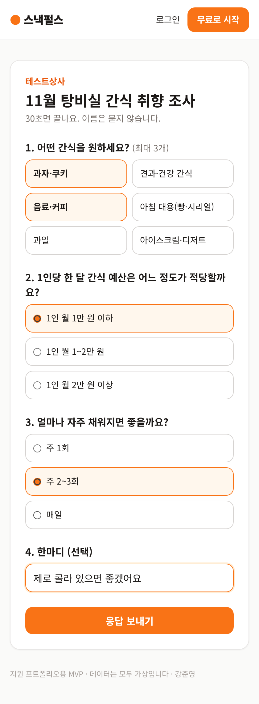
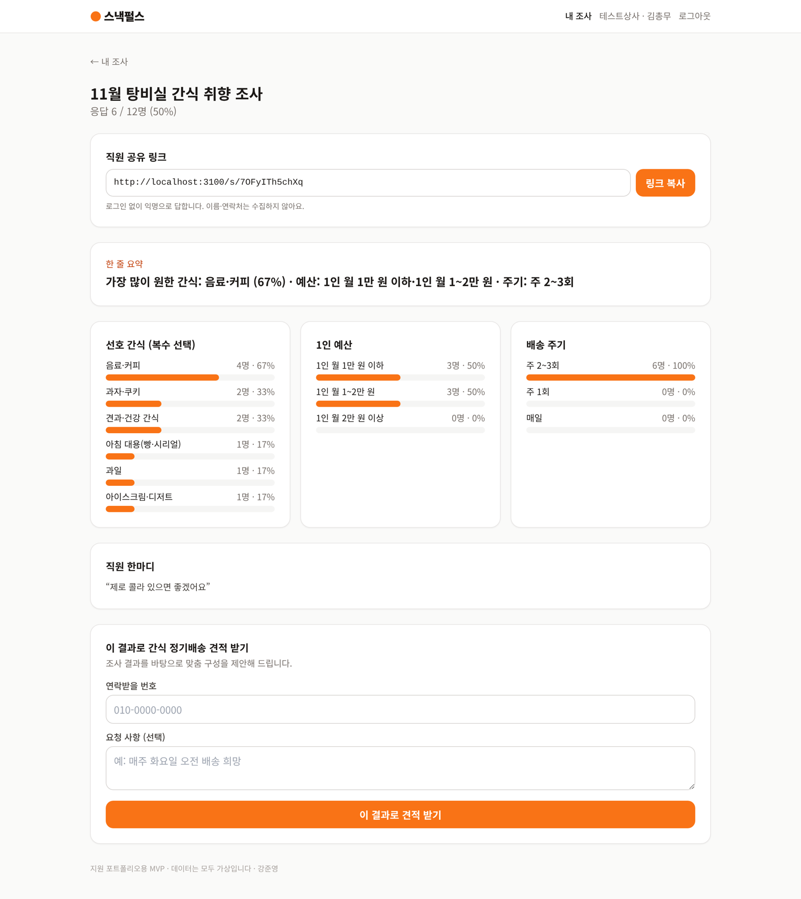
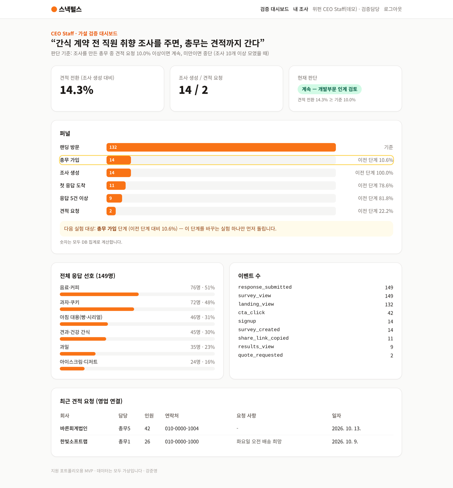

# 스낵펄스 (office-snack-pulse)

> 사무실 간식 취향 조사 MVP — **"간식 계약 전 직원 취향 조사를 무료로 주면, 총무는 견적까지 간다"** 를 검증하기 위한 웹 서비스

위펀 [CEO Staff] 풀스택 개발자 지원 포트폴리오로, 공고의 업무 방식(가설 > 최소 범위 > 단독 구현 > 지표로 판단 > 인계)을 그대로 따라 1일 안에 만들었습니다. 회사·사람·응답 데이터는 모두 가상입니다.

## 1. 가설과 판단 기준

| 항목 | 내용 |
|---|---|
| 대상 | 직원 50명 이하 사무실의 총무·인사 담당자 |
| 문제 | 간식 정기배송을 계약하려 해도 직원이 뭘 원하는지 몰라 결정을 미룬다 |
| 가설 | 직원 취향 조사를 무료로 만들어 주면, 결과를 본 총무가 견적 요청까지 간다 |
| 핵심 지표 | **견적 전환** = 견적 요청 수 / 조사 생성 수 |
| 판단 | 조사 10개 이상 모였을 때 견적 전환 **10% 이상이면 계속**, 미만이면 중단 검토, 10개 미만이면 보류 |
| 다음 실험 | 퍼널에서 이전 단계 대비 전환이 가장 낮은 단계를 자동으로 표시 |

판단 규칙은 `lib/metrics.ts`의 `decide()`, 기준값은 `lib/options.ts`의 `DECISION` 한 곳에만 있습니다.

## 2. 화면

| 누가 | 화면 | 하는 일 |
|---|---|---|
| 방문자 | `/` | 랜딩, CTA |
| 총무 | `/signup`, `/login`, `/dashboard` | 가입, 조사 생성(제목·인원), 내 조사 목록 |
| 총무 | `/dashboard/surveys/[id]` | 공유 링크 복사, 결과(응답 5건 이상부터), 견적 요청 |
| 직원 | `/s/[token]` | 로그인 없이 익명 응답 (간식 1~3개, 예산, 주기, 한마디) |
| 내부 담당(staff) | `/admin` | 퍼널, 견적 전환, 현재 판단, 다음 실험 대상, 견적 요청 목록 |

## 3. 무엇을 지키고 무엇을 생략했나

**반드시 지킨 것**
- **인가 경계는 서버에서**: 조사 결과는 만든 총무와 staff만, 견적 요청은 만든 총무만, 검증 대시보드는 staff만. 남의 조사는 존재 여부도 드러내지 않고 404
- **개인정보 최소 수집**: 직원 응답에는 이름·이메일을 받지 않음. 중복 응답 방지는 브라우저 식별값의 SHA-256 해시만 저장. 직원 화면에는 조사 제목·회사명만 노출
- **인증**: bcrypt 해시, 로그인 5회 실패 시 10분 잠금, 없는 계정과 틀린 비밀번호는 같은 메시지, httpOnly 세션 쿠키(8시간), 배포 시 `SESSION_SECRET` 없으면 기동 실패
- **입력 검증**: 모든 입력을 Zod로 서버에서 검증(간식 1~3개, 목록 밖 값 거부, 연락처 형식)
- **숫자는 코드가 계산**: 결과·퍼널 수치는 DB 집계, 동률 1위는 한쪽만 고르지 않고 모두 표시
- **행동 데이터**: 판단에 필요한 9개 이벤트만 허용 목록으로 기록 (`landing_view`, `cta_click`, `signup`, `survey_created`, `share_link_copied`, `survey_view`, `response_submitted`, `results_view`, `quote_requested`)

**일부러 생략한 것 (검증 목적 밖)**
- 이메일 인증·비밀번호 찾기, 조사 수정·삭제, 다국어, 결제
- 견적 요청 후 알림(메일·슬랙) — 지금은 staff 대시보드 목록으로 확인
- A/B 테스트 도구 연동 — 퍼널이 기준을 넘으면 다음 단계에서 붙임

## 4. 기술 구성

- Next.js 15 (App Router, Server Actions) · React 19 · TypeScript · Tailwind CSS
- Drizzle ORM · PostgreSQL — `DATABASE_URL`이 있으면 Supabase·Neon 등 PostgreSQL, 없으면 내장 PGlite(로컬 파일 DB)로 같은 코드가 동작
- Zod(입력 검증) · jose(세션 서명) · bcryptjs
- Vitest 자동 테스트 19개 · GitHub Actions CI

```
app/            화면과 Server Actions (actions.ts)
components/     화면 조각
lib/services.ts 업무 규칙과 인가 경계 (화면과 분리해 테스트)
lib/metrics.ts  퍼널·판단 규칙·집계 (순수 함수)
lib/schema.ts   Drizzle 스키마 / lib/bootstrap.ts 테이블 생성 SQL
scripts/seed.ts 가상 데이터 (14개 회사, 응답 150여 건)
tests/          단위·통합 테스트
docs/HANDOFF.md 개발부문 인계 문서
```

## 5. 실행

```bash
npm install
npm run seed      # 가상 데이터 채우기 (개발 서버를 끈 상태에서)
npm run dev       # http://localhost:3000
npm test
```

데모 계정 (가상, 데모 전용)
- 내부 담당(staff): `admin@snackpulse.test` / `demo-admin-1234`
- 총무: `demo@hanbit.test` / `demo-1234!`

배포(Vercel): 저장소를 연결하고 환경 변수 `DATABASE_URL`(Supabase 등 PostgreSQL), `SESSION_SECRET`(32자 이상 무작위)을 넣습니다. 첫 요청 때 테이블이 생성됩니다.

## 6. 테스트가 확인하는 것

- 퍼널 전환율 계산, 0으로 나누지 않음, 판단 규칙(보류·계속·중단), 다음 실험 대상 선택, 동률 처리
- 중복 가입 거부, 가입은 항상 manager 권한, 로그인 5회 실패 잠금과 해제, 계정 존재 여부 비노출
- 다른 총무는 내 조사 결과 접근 불가, staff는 조회 가능하지만 견적 대리 요청 불가, 대시보드 집계는 staff 전용
- 직원 공개 정보에 총무 이메일이 없음, 같은 브라우저 중복 응답 차단, 입력값 범위 검증, 결과 집계가 저장된 응답과 일치

이와 별도로 실제 브라우저로 가입 > 조사 생성 > 직원 6명 응답(중복 시도 포함) > 결과 > 견적 > 다른 총무 접근 차단 > 로그인 잠금 > 내부 대시보드까지 끝까지 눌러 확인했습니다.

## 7. 만들면서 고친 문제

| 발견 | 원인 | 조치 |
|---|---|---|
| 응답 5건 이상 조사가 퍼널에서 0으로 집계 | 하위 질의 집계값과 기준값을 비교하는 SQL 조건이 기대대로 동작하지 않음 | 조사별 응답 수는 DB에서 집계하고 단계 비교는 코드로, 재발 방지 테스트 추가 |
| 입력 오류 후 다시 제출하면 가입이 안 됨 | React 19가 액션 후 폼을 비워 필수값이 사라짐 | 오류 시 입력값(비밀번호 제외)을 돌려줘 다시 채움 |
| 예산이 동률인데 한쪽만 1위로 요약 | 정렬 결과의 첫 값만 사용 | 동률 1위를 모두 표시, 테스트 추가 |

## 8. 한계

- 가상 데이터라 실제 총무의 반응은 검증되지 않았습니다. 실제 판단은 배포 후 실사용 데이터로 합니다.
- 중복 응답 방지는 쿠키 기준이라 브라우저를 바꾸면 다시 답할 수 있습니다(검증 단계에서는 허용, 운영 시 사내 인증 연동 검토).
- 테이블 생성은 시작 시 SQL로 합니다. 개발부문 인계 후에는 drizzle-kit 마이그레이션으로 바꿉니다.
- 개발에 AI 코딩 도구(Claude)를 사용했습니다. 무엇을 만들고 생략할지와 판단 기준은 직접 정했고, 동작은 자동 테스트와 브라우저 확인으로 검증했습니다.

## 9. 화면 캡처

| 랜딩 | 직원 응답 (모바일) |
|---|---|
|  |  |

| 총무 결과·견적 | 내부 검증 대시보드 |
|---|---|
|  |  |
